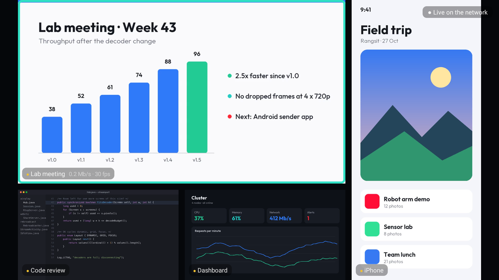
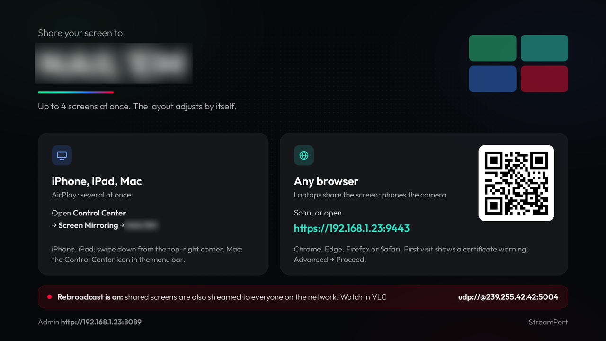
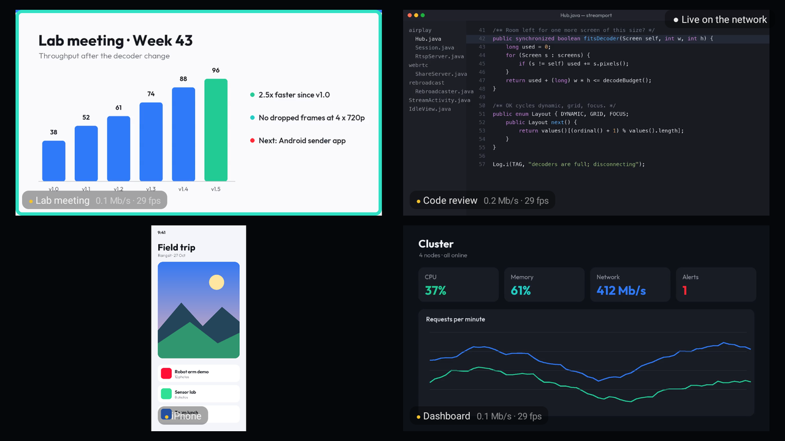
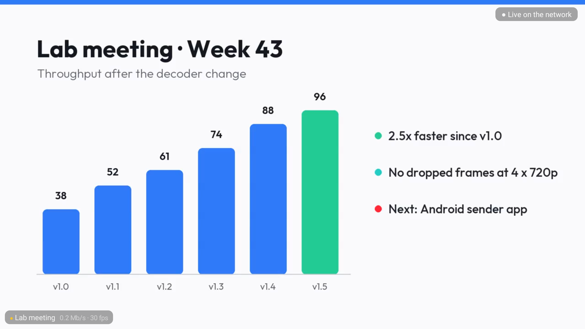
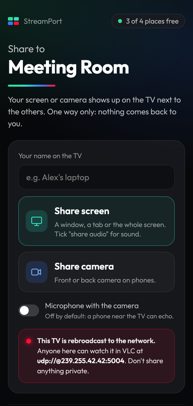
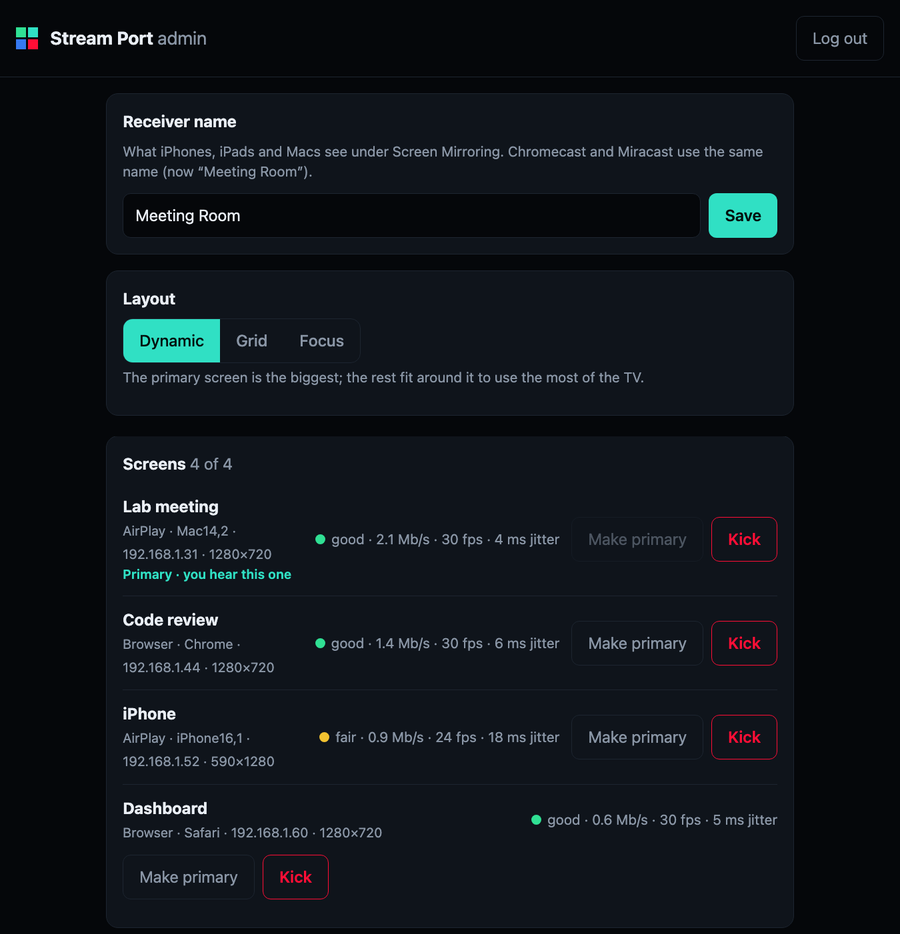

  <picture>
    <source media="(prefers-color-scheme: dark)" srcset="docs/logo-dark.png">
    
  </picture>

Share screens to a TV, several at once, laid out automatically. Built for the NAIL'EM lab.

| Folder | What |
|---|---|
| [`androidbox/`](androidbox/) | **StreamPort for Android TV boxes**: AirPlay mirroring (iPhone, iPad, Mac) and browser sharing (screen or camera, WebRTC/WHIP) from up to 4 senders at once, an admin page, and an optional LAN rebroadcast for VLC. Tested on the Xiaomi TV Box S (2nd gen, Android 11). |

## What it looks like

| | |
|---|---|
|  |  |
| **Welcome screen.** How to share from an iPhone, iPad or Mac (AirPlay) or any browser, with this box's own name and address. | **Grid layout.** OK on the remote cycles Dynamic (top), Grid and Focus. |
|  |   |
| **Focus layout.** Only the primary screen; Left and Right switch between senders. | **Share page** (left) for browsers: screen or camera. **Admin page** (right): name, layout, limits, kick. |

The screens shown are made-up examples sent with `androidbox/tools/test_sender.py --image`.

## Install on an Android TV box

Download `streaming-port.apk` from the [latest release](https://github.com/kapong/streaming-port/releases/latest)
and install it with `adb`. The steps, the one-time permissions and the recommended limits are in
[`androidbox/README.md`](androidbox/README.md#install-on-a-box-release-apk).

## Security

The receiver is meant for a trusted LAN: senders are accepted without asking (switchable), the admin page is
plain HTTP behind a PIN shown on the TV, and the browser page uses a self-signed certificate. The full review is in
[`androidbox/SECURITY.md`](androidbox/SECURITY.md).

## License

GPL-3.0 (see [LICENSE](LICENSE)), because the FairPlay handshake is derived from GPL-3.0 code. Third-party code and
fonts keep their own licenses: [`androidbox/THIRD_PARTY.md`](androidbox/THIRD_PARTY.md).
